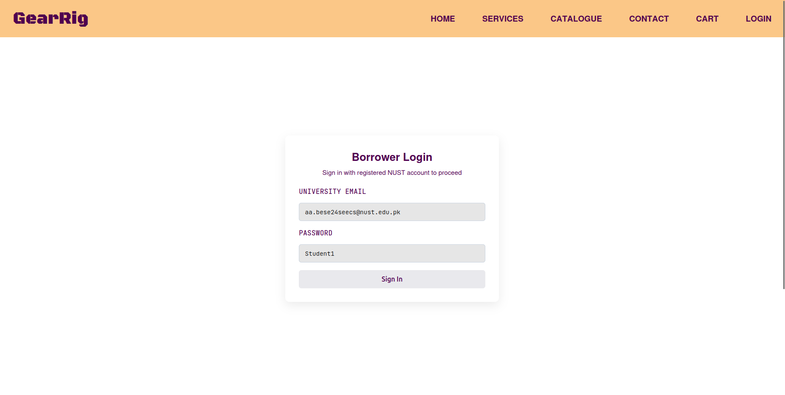
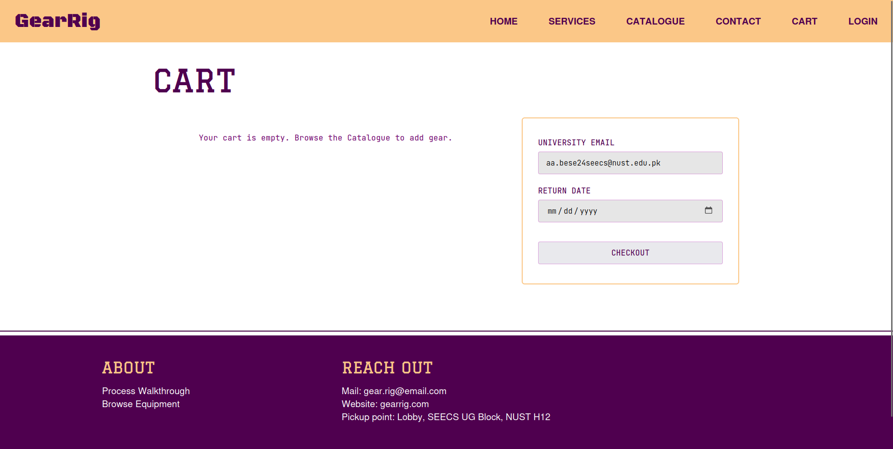
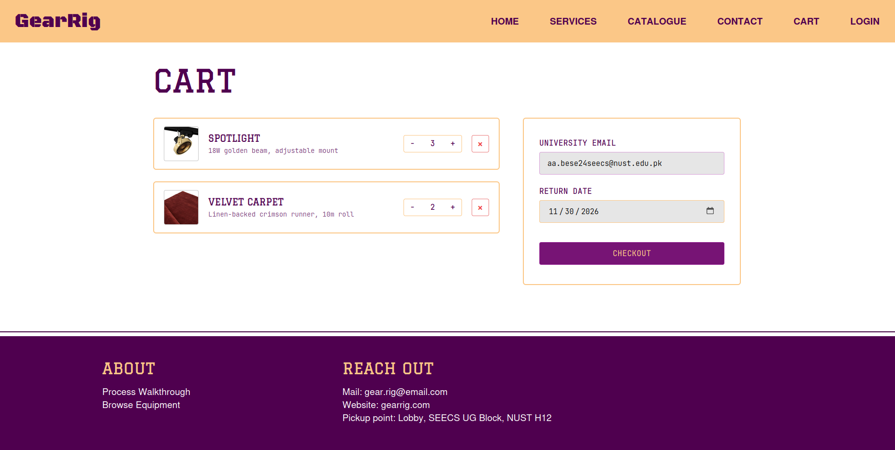
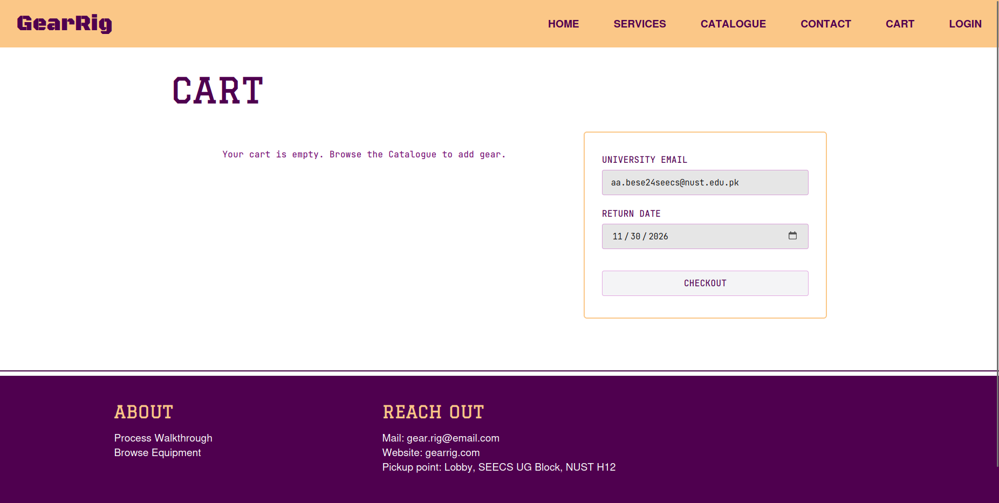
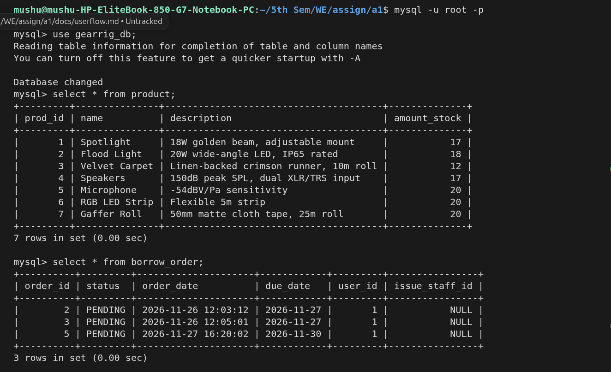

# User flow

## Role: Borrower

Documents the happy path for user playing the role 'borrower'

### User signs in

Fig. Sign in

Fig. Cart empty initially upon sign in

### Adds equipment to cart

Fig. Browse equipment from catalogue

### Checkout cart

Fig. Cart before checkout

Fig. Cart cleared after checkout 

### Updates made in database

Fig. Products have stock amount decremented and order is recorded.