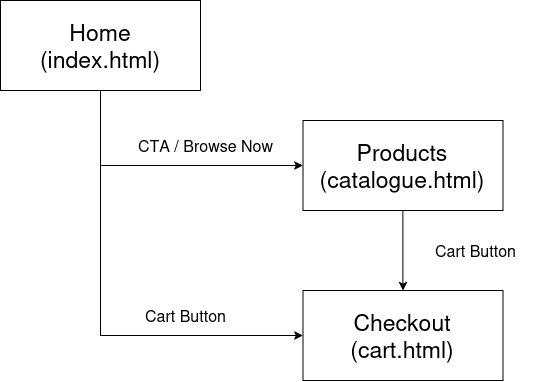

*Web Development Life Cycle (WDLC) Documentation*

# 1. Information Gathering

>[!TIP] 
> Scoped from doc: [Design Note](./design-note.md)

**As-Is System:** Manual paper sheets and email bookings causing tracking delays.
**Core Problems:**
* **P1:** Stale stock data (late updates cause false availability).
* **P2:** Untracked damage (no handover/return condition logs).
* **P3:** Untraceable borrowers (unverified contact details).

**Key Requirements:**
* Live inventory tracking & fast UI filtering.
* Mandatory `@nust.edu.pk` institutional email verification.
* Return-date limits (up to 4 months) & condition logging.

**Scope:** Frontend client-side prototype (`localStorage`); excludes backend databases and payments.


# 2. Planning
*Wireframe and Sitemap created on Draw.io*
([Link](https://drive.google.com/file/d/1fpGi3JjfIf-3zHNsW-CHaH2bYRACdui1/view?usp=drive_link))

## Sitemap


## Wireframe
Wireframes are added in [Wireframe DOC](./wireframe.md)

# 3. Design and Layout

## Design Process & Rationale

Equipment checks for logistics and an element of excitement (fast paced, modern and standardized) in gaphic design

Theatrical and live-event vocabulary to show importance of pre-planning infrastructure for runtime management.

## Typography: Fonts and Colours

**Colours:**
*To convey event excitement with glow colours*
- Soft yellow/golden accents against constrasting dark purple colour with lighter accents
- not blue else it'll look like a corporate app

**Fonts:**

- Helvetica, serif for normal body text
- JetBrainsMono/ Monospace font for details, convey logistics accuracy
- BlackOps for logo art, stenciled feel convey's DIY projects/ signboard creation, matching the university scenario of equipment arrangements
- LibraBarcode for token code (shows text with barcode)
- Graduate for headings, slabs give rigid feel, helping with heirarchy placement and providing uniform, relaible feel, which works well for logistics.

## Component Specifications

User interface blueprints and feel

### 1. Catalogue Card Layout (`.product-cell`)
* **Product Image Box:** Clean framed thumbnail container.
* **Product Name:** Uppercase display typography (`Graduate`).
* **Specifications:** Single-line clamped text (`JetBrainsMono`).
* **Category Badges:** Compact pill tags showing colors and categories.
* **Stock Indicator:** Dynamic status dot with quantity counter (`#22c55e` green for available amounts, `#6b7280` gray for out of stock).

### 2. Catalogue Filters (Triple Set Side-by-Side)
* **Category:** Electronics, Staging, Misc
* **Colours:** None, All, VIBGYOR, BW, Gold, Silver
* **Status:** Available, Not Available

## Data Modeling & Schemas

### 1. Equipment Schema & Constraints
* **Rules:** At least 1 category is mandatory (can be multiple); color attribute is optional and can be multiple.
```json
{
  prodId, 
  name, 
  desc, 
  amountStock, 
  colour: [], 
  categories: [ electronics, staging ]
}
```
#### Initial Equipment Inventory Seed

```txt
Spotlight: 18W golden beam, adjustable mount | Stock: 12 | Color: Gold | Categories: Staging, Electronics
Flood Light: 20W wide-angle LED, IP65 rated | Stock: 0 | Color: White | Categories: Electronics
Velvet Carpet: Linen-backed crimson runner, 10m roll | Stock: 6 | Color: Red | Categories: Staging
Speakers: 150dB peak SPL, dual XLR/TRS input | Stock: 4 | Color: None | Categories: Electronics
Microphone: -54dBV/Pa sensitivity | Stock: 9 | Color: None | Categories: Electronics
```

### 2. Borrow record schema

A person may borrrow multiple products
```json
{ 
  tokenNumber, 
  email, 
  returnTime,
  borrows: [ 
    (prodId, amountBorrowed),
    (prodId, amountBorrowed) 
  ] 
}
```

#### Initial Student Borrow Seeds

```txt
aa.bese24seecs@nust.edu.pk : 5th Dec 2026, [(flood light, 2), (spotlight, 1)]
bb.bese26seecs@nust.edu.pk : 18th Dec 2026, [(speaker, 3)]
cc.beee23seecs@nust.edu.pk : 4th Jan 2027, [(velvet carpet, 10), (flood light, 3), (spotlight, 4)]
dd.beee23seecs@nust.edu.pk : 15th Feb 2027, [(speaker, 5), (microphone, 4)]
ee.bsds25seecs@nust.edu.pk : 28th Nov 2026, [(speaker, 2), (red carpet, 4), (flood light, 1), (spotlight, 1)]
```
### 3. Cart schema

A current cart has productID with the quantity. The quantity is greater than 0 and less than equal to available stock
```json
{ 
  prodID,
  amount
}
```
# 4. Content Creation

**Name:** GearRig (Responsible & professional Depot to store and obtain quality equipment)

**Slogan:** Because the show must go on (convey sense of urgency)

**Landing Page:**

Borrow items ethically and responsibly. Search among a catalogue of quality and variety products

- [CTA] Take me there : catalogue.html
- [CTA] How it works : process section

**Process flow:**

```
[ 1. Browse & Select ]
       │
       ▼ (User adds items & updates quantities in cart.html)
[ 2. Authentication ]
       │
       ▼ (User enters student email & requested borrow duration)
[ 3. Token Generation ]
       │
       ▼ (System validates availability & issues a secure Order Token)
[ 4. Depot Claim ]
       │
       ▼ (User brings token proof to physical depot to claim equipment)
[ 5. Active Deployment & Return ]
       │
       └─► (User returns gear within agreed duration to close loop)
```

# 5. System Design & Development

To maintain a lightweight, fast-loading prototype without a backend server, state management and data handling are handled entirely on the client side using browser storage and decoupled modular functions. 

#### 1. State Persistence (`localStorage`) and Data Handling
The application relies on two primary state keys to synchronize data across multi-page navigation (`catalogue.html` and `cart.html`):
* **`gearRigEquipment`**: Stores the persistent array of equipment objects, tracking live stock updates, categories, and attributes. Falls back to default seed data if empty.
* **`gearRigCart`**: Stores the active list of user-selected items mapped by `prodId` and `quantity`.

#### 2. Data Flow & Transaction Cycle
1. **Catalog Browsing:** `initializeCatalogue()` reads from equipment storage, renders reactive stock indicators, and binds add-to-cart actions.
2. **Cart Accumulation:** Selecting items pushes or increments records into the cart array, enforcing maximum stock bounds and storing the state in `localStorage`.
3. **Checkout & Stock Reduction:** 
   * Validates student identity against institutional email constraints (`.edu.pk`).
   * Validates return date boundaries (Current day to a maximum of 4 months out).
   * Dynamically decrements live stock counts within `equipmentData` based on cart quantities.
   * Clears the cart array and re-syncs updated inventories back to local storage.

#### 3. Separation of Concerns (Modular Script Design)
Functions are cleanly isolated by responsibility and invoked explicitly via page lifecycle hooks rather than global event listeners:
* **`initializeCatalogue()`**: Manages product grid generation and stock-aware button states on the catalogue page.
* **`initializeCart()`**: Manages cart table rendering, dynamic date input constraints, and item availability checks.
* **`attachCartActionListeners()`**: Handles granular quantity increments, decrements, and item deletion.
* **`setupCheckoutHandler()`**: Encapsulates form submission, email domain validation, stock deduction, and cart resetting.

# 6. Testing and Launch

## Edge cases

### 1. Cart & Inventory Constraints
* **Stock Limit:** Cart quantity cannot exceed total available stock; the `+` increment button disables automatically when max stock is reached.
* **Checkout State:** Completing checkout deducts quantities from live inventory, reflects decreased stock in the catalogue, and completely resets the cart.

### 2. Form & Date Partitioning
* **Return Date:** Must be strictly greater than or equal to the current day, and cannot exceed a maximum duration of 4 months out.
* **Email Domain Validation:** Must match a valid university domain ending strictly with `.edu.pk` / `@nust.edu.pk`.
* **Empty Cart Guard:** If the cart array is empty, checkout controls are locked/disabled and no token records are generated.

## Launch

Launched via github actions for static html sites. No specific dependencies/ rule sets were required

# 7. Maintenance & Updates

## Future development

- **Filter and Search:** options to filter equipment in catalogue
- **Add Privacy policy:** no data taken except for student email for verification of identity. History of student items borrowed and returned
- **Student Registration and Signin:** track record maintained in database 
- **Race conditions:** time between email verification and order confirmation (Add internal order verification stage in the backend)
